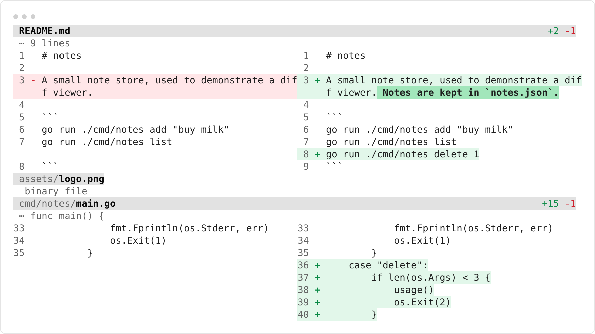
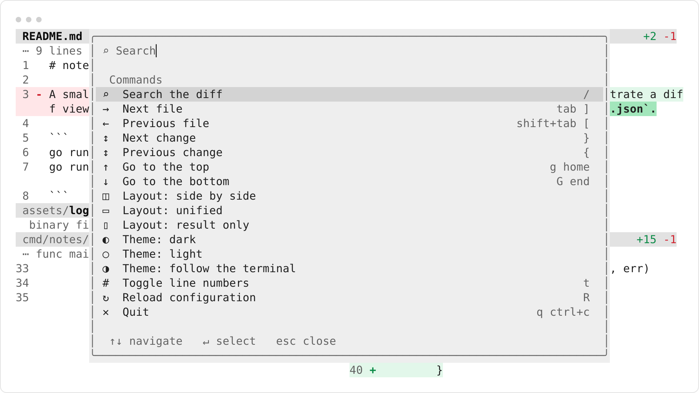

<picture>
  <source media="(prefers-color-scheme: dark)" srcset="assets/header-dark.png">
  <source media="(prefers-color-scheme: light)" srcset="assets/header-light.png">
  
</picture>

# drif

A terminal diff viewer. Run it inside a worktree and see everything that changed from the base
branch, as one continuous review surface.

```sh
$ cd ~/room/code/worktrees/opencode-site
$ drif
```

One command, no setup. It reads the repository you are standing in, compares the merge base of the
base branch against your working tree, and draws the result the way a review should look: split or
unified, changed lines tinted, everything else quiet.

## Install

```sh
# Homebrew
brew install fschrhunt/drif/drif

# or the installer: checksum-verified release, into ~/.local/bin
curl -fsSL https://raw.githubusercontent.com/fschrhunt/drif/main/install.sh | sh
```

From a checkout:

```sh
go install ./cmd/drif
ln -sf drif "$(go env GOPATH)/bin/git-drif"
```

The `git-drif` link makes `git drif` work; git looks up `git-<name>` on `PATH`. Releases carry a
build provenance attestation: `gh attestation verify <archive> -R fschrhunt/drif`.

## What it does

- **One surface, not a file viewer.** The whole change set scrolls as a document. The file header
  is pinned to the top and follows the file you are reading.
- **Colour means exactly two things.** Added is green, removed is red, and only changed lines paint
  a background. Everything structural is ink, so drif adapts to your terminal instead of covering
  it.
- **Split, unified, or result only.** `s` cycles: compare both sides, fold into one column, or hide
  the deletions and read what the file became.
- **Long lines wrap**, in one column and in both halves of the split. No horizontal scrolling.
- **Word-level emphasis** inside changed pairs, so a one-character edit reads as a one-character
  edit.
- **Hunk boundaries read like prose** — `⋯ func main()` instead of `@@ -1,8 +1,9 @@`.
- **`--watch`** reloads the surface as you edit.

## The command palette

`?` opens it, `/` opens it in search mode. There is nothing printed on screen telling you which key
does what; the palette is the only place the interface explains itself.

<picture>
  <source media="(prefers-color-scheme: dark)" srcset="assets/palette-dark.png">
  <source media="(prefers-color-scheme: light)" srcset="assets/palette-light.png">
  
</picture>

Search lists matching lines with `file:line` and jumps on Enter, leaving the matches available to
`n` and `N`. The input has a real caret: arrows move it, Home/End jump, Backspace and Delete edit in
place. The panel floats over the diff rather than replacing it, so you keep your place.

## Usage

```
drif                      review the working tree
drif --base origin/main   compare against something else
drif --file render.go     one file only
drif --layout split       start in a specific layout
drif --list               one line per changed file
drif --json               the change set as JSON
git diff | drif           render a patch
```

Bare `drif` includes staged, unstaged and untracked files, and leaves out commits that landed on
the base branch after you branched. Everything under the current directory is in scope; run it from
`src/` and you only see `src/`.

The base is found from `--base`, `$DRIF_BASE`, `git config drif.base`, `origin/HEAD`,
`origin/main`, `origin/master`, `main`, then `master`. If the base is wrong, `drif --base <ref>`
tells it once. `drif config` shows the revision actually being compared.

## Configuration

Nothing has to be configured. The file exists for the handful of things worth remembering.

```sh
drif init     # write a commented config
drif config   # show what is actually in effect
```

It lives at `~/.config/drif/config.toml` (`$XDG_CONFIG_HOME/drif/config.toml`, or
`$DRIF_CONFIG_DIR`; override the file itself with `--config`). Every key is optional — delete a
line and the built-in behaviour comes back.

```toml
theme = "auto"      # auto follows the terminal
layout = "auto"     # auto, split, unified, new
context = 3
numbers = true

[keys]
quit = ["x"]
next_file = ["J"]

[colors]
add_bg = "#10241a"
```

Flags override the file, and only when you actually pass them.

### Per repository

One setting belongs to the project rather than to you: which branch it forks from. Put a
`.drif.toml` at the repository root and everyone who clones it compares against the right place.

```toml
base = "develop"
```

`drif init --repo` writes one. That is the whole schema, on purpose: a repository may say **what** to
compare against, never **how** the diff is painted. Themes, colours, keys and layout are rejected
there, because a review tool whose presenter can be set by the thing being reviewed can be made to
lie.

## Themes

Two palettes ship and the terminal picks between them by reporting its own background. To change the
look, layer on top of it:

```toml
[colors]
add_bg = "#10241a"
del_bg = "#2a1417"
```

Or write `~/.config/drif/themes/<name>.toml` and set `theme = "<name>"`:

```toml
extends = "dark"     # dark, light, auto, or another theme

[colors]
add_fg = "#b8f397"
```

`extends` inherits everything else, so a theme can be one line. `drif theme` lists what is
installed and `drif theme NAME` prints one as a file to copy. Inside the viewer, `:theme <name>`
switches immediately and `R` re-reads the config, so you can tune a theme with the file open in
another window.

## Keys

Every action is rebindable; `?` shows the live list. The defaults:

```
j k ↓ ↑      line                 space b         page
g G          top / bottom         } {             next / prev hunk
tab ]        next file            shift+tab [     prev file
s            split → unified → new
/            search               n N             next / prev match
t            line numbers         :               command
R            reload config        ?               palette
q            quit
```

Written the way your terminal reports them: `j`, `G`, `ctrl+d`, `tab`, `shift+tab`, `pgdown`,
`space`, `enter`, `esc`. Multi-key sequences are not supported, and a key can only do one thing —
a conflict is an error, not a surprise.

## For agents

`drif --list` then `drif --file PATH` is the same shape as `git diff --stat` then
`git diff -- PATH`, so there is nothing new to learn:

```sh
$ drif --list
M	internal/render/render.go	+7	-7
A	notes.txt	+1	-0

$ drif --file notes.txt
```

`--json` emits the full structure with a versioned schema. When output is not a terminal nothing is
coloured, nothing paginates and nothing waits for input, so piping is always safe. `--context 0`
gives the most token-frugal patch, and `--exit-code` returns 1 when anything changed.

Config and themes never change the machine-readable output: `--json` returns the patch as git
produced it. Terminal control characters in file content are rendered as visible pictures rather
than sent to the terminal.

## How it works

drif renders patches; it does not implement git. It asks git for the diff, parses the unified patch,
and lays the hunks out as rows. Every surface — split, unified, pager, plain text, JSON — reads
those same rows, so what you see interactively is what an agent gets.

Rows are independent of terminal width; wrapping and truncation happen at draw time, which keeps the
pager and the viewport from disagreeing. The design decisions behind that are in
[docs/plan.md](docs/plan.md).

## Development

```sh
./x            # format check, vet, build, race tests
./x review     # build this checkout and review its own changes with it
./x demo       # build the demo repository and review it
```

`./x demo --edges` builds the awkward repository — binary, symlink, CRLF, non-ASCII paths, mode-only
changes — for when you are changing the renderer rather than judging the experience.
