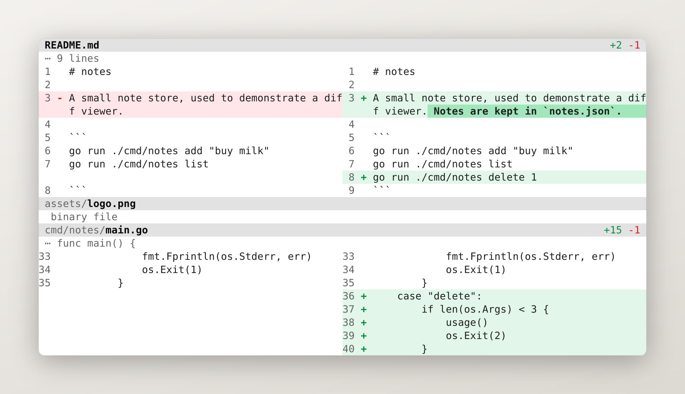

<p align="center">A terminal diff viewer for a worktree.</p>

<p align="center">
  <a href="https://github.com/fschrhunt/drif/releases"></a>
  <a href="https://github.com/fschrhunt/drif/actions/workflows/ci.yml"></a>
  <a href="LICENSE"></a>
</p>

<p align="center">
  
</p>

---

### Installation

```bash
# installer: checksum-verified release into ~/.local/bin
curl -fsSL https://raw.githubusercontent.com/fschrhunt/drif/main/install.sh | sh

# Homebrew
brew install fschrhunt/drif/drif

# from a checkout
go install ./cmd/drif && ln -sf drif "$(go env GOPATH)/bin/git-drif"
```

The `git-drif` link makes `git drif` work; git looks up `git-<name>` on `PATH`. Releases carry a build
provenance attestation:

```bash
gh attestation verify <archive> -R fschrhunt/drif
```

### What it does

Run it inside a worktree and it reviews everything changed since the base branch — staged, unstaged
and untracked — as one surface.

- **One surface, not a file viewer.** The whole change set scrolls as a document. The file header is
  pinned to the top and follows the file you are reading.
- **Colour means exactly two things.** Added is green, removed is red, and only changed lines paint
  a background. Everything structural is ink, so drif adapts to your terminal instead of covering
  it.
- **Split, unified, or result only.** `s` cycles: compare both sides, fold into one column, or hide
  the deletions and read what the file became.
- **Long lines wrap**, in one column and in both halves of the split. No horizontal scrolling.
- **Word-level emphasis** inside changed pairs, so a one-character edit reads as a one-character
  edit.
- **Hunk boundaries read like prose** — `⋯ func main()` instead of `@@ -1,8 +1,9 @@`.
- **`--watch`** reloads the surface as you edit.

### Command palette

`?` opens the palette, `/` opens it in search mode. Nothing on screen tells you which key does
what; the palette is the only place the interface explains itself.

Search lists matching lines with `file:line` and jumps on Enter, leaving the matches available to
`n` and `N`. The input has a real caret: arrows move it, Home/End jump, Backspace and Delete edit in
place. The panel floats over the diff rather than replacing it.

### Usage

```
drif                      review the working tree
drif --base origin/main   compare against something else
drif --file render.go     one file only
drif --layout split       start in a specific layout
drif --list               one line per changed file
drif --json               the change set as JSON
git diff | drif           render a patch
```

Bare `drif` includes staged, unstaged and untracked files, and leaves out commits that landed on
the base branch after you branched. Everything under the current directory is in scope; run it from
`src/` and you only see `src/`.

The base is found from `--base`, `$DRIF_BASE`, `git config drif.base`, `origin/HEAD`,
`origin/main`, `origin/master`, `main`, then `master`. `drif config` shows the revision actually
being compared.

### Configuration

Nothing has to be configured. The file exists for the handful of things worth remembering.

```bash
drif init     # write a commented config
drif config   # show what is actually in effect
```

```toml
theme = "auto"      # auto follows the terminal
layout = "auto"     # auto, split, unified, new
context = 3
numbers = true

[keys]
quit = ["x"]

[colors]
add_bg = "#10241a"
```

A repository can also carry `.drif.toml` at its root, declaring only `base` — what to compare
against, never how the diff is painted.

Full reference: **[docs/configuration.md](docs/configuration.md)** — options, per-repository
settings, themes, key bindings and the in-viewer command line.

### For agents

`drif --list` then `drif --file PATH` is the same shape as `git diff --stat` then
`git diff -- PATH`, so there is nothing new to learn:

```bash
$ drif --list
M	internal/render/render.go	+7	-7
A	notes.txt	+1	-0

$ drif --file notes.txt
```

`--json` emits the full structure with a versioned schema. When output is not a terminal nothing is
coloured, nothing paginates and nothing waits for input. `--context 0` gives the most token-frugal
patch and `--exit-code` returns 1 when anything changed. Config and themes never change the
machine-readable output.

### How it works

drif renders patches; it does not implement git. It asks git for the diff, parses the unified patch
and lays the hunks out as rows. Every surface — split, unified, pager, plain text, JSON — reads
those same rows, so what you see interactively is what an agent gets. The design decisions are in
[docs/plan.md](docs/plan.md).

### Contributing

```bash
./x            # format check, vet, build, race tests
./x review     # build this checkout and review its own changes with it
./x demo       # build the demo repository and review it
```

See [CONTRIBUTING.md](CONTRIBUTING.md) and [AGENTS.md](AGENTS.md). Security reports go through
[private vulnerability reporting](SECURITY.md).

---

<p align="center">
  <a href="https://github.com/fschrhunt/drif">GitHub</a> ·
  <a href="https://github.com/fschrhunt/drif/releases">Releases</a> ·
  <a href="LICENSE">MIT</a>
</p>
